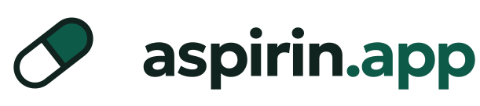

  <picture>
    <source media="(prefers-color-scheme: dark)" srcset="logo-on-dark.svg">
    
  </picture>

# aspirin.app brand assets

Official logos, colours and images of [aspirin.app](https://aspirin.app).

## Files

| File | Size | Use it for |
| --- | --- | --- |
| [logo.svg](logo.svg) | vector | Main logo on light backgrounds |
| [logo-on-dark.svg](logo-on-dark.svg) | vector | Logo on dark backgrounds |
| [mark.svg](mark.svg) | vector | The capsule mark on its own, where space is small |
| [favicon.svg](favicon.svg) | vector | Browser tab icon |
| [favicon-32.png](favicon-32.png) | 32 × 32 | Browser tab icon for older browsers |
| [icon-192.png](icon-192.png) | 192 × 192 | Web app icon |
| [icon-512.png](icon-512.png) | 512 × 512 | Web app icon, profile pictures |
| [icon-maskable-512.png](icon-maskable-512.png) | 512 × 512 | Android icon with safe zone for round or squircle masks |
| [apple-touch-icon.png](apple-touch-icon.png) | 180 × 180 | Home screen icon on iPhone and iPad |
| [social-preview.png](social-preview.png) | 1280 × 640 | Link previews and social sharing |

## Colours

| Name | Light theme | Dark theme | Where |
| --- | --- | --- | --- |
| Accent | `#0E5A49` | `#6CCBAA` | Capsule half, ".app" in the logo, buttons |
| Ink | `#11231E` | `#E3ECE8` | Text and the capsule outline |
| Paper | `#F3F5F2` | `#0B1412` | Page background |
| Surface | `#FFFFFF` | `#111D1A` | Cards, the light half of the capsule |
| Deep green | `#0C392F` | `#0F2B25` | Dark sections |
| Deep accent | `#8EE0BF` | `#8EE0BF` | Accent on deep green |
| Mint | `#DCEBE4` | `#173A31` | Soft highlights |
| Pill yellow | `#E7B24E` | `#D9A443` | Small accents |

## Typography

- **Geologica** for the logo and headings
- **Ysabeau Office** for body text
- **Martian Mono** for codes and small labels

All three fonts are licensed under the [SIL Open Font License 1.1](https://openfontlicense.org). They are not owned by aspirin.app and keep their own licence. In the SVG logos the letters are converted to outlines, so no font file is needed.

## How to write the name

- Always **aspirin.app**: all lowercase, one word, with ".app".
- Do not write "Aspirin App", "AspirinApp" or "ASPIRIN.APP".
- aspirin.app is independent and not affiliated with Bayer AG. Aspirin® is a registered trademark of Bayer AG.

## Please do not change the logo

Use the files as they are. Do not redraw, stretch, rotate, recolour, add effects or put the logo on busy backgrounds. Leave clear space around it. If you need a version that is not here, email [info@aspirin.app](mailto:info@aspirin.app).

## Licence

All rights reserved. See [LICENSE](LICENSE).
